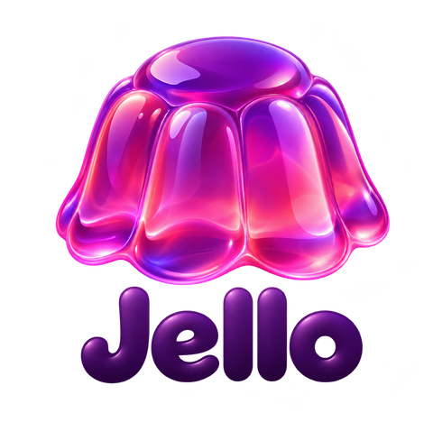
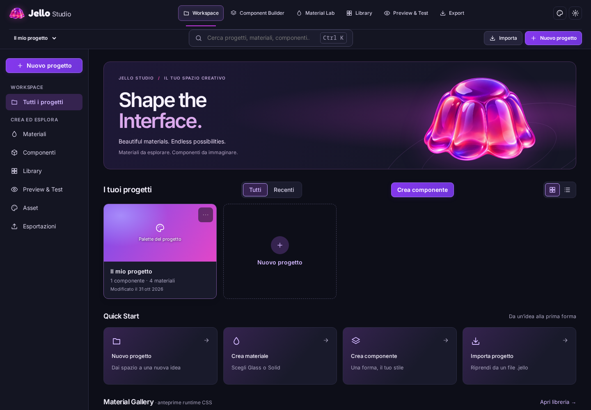

# Jello Studio





Jello Studio è un ambiente visuale di materiali e componenti UI, riutilizzabili su web desktop, browser
mobile e app Android basate su WebView. Workspace, Component Builder, Material Lab, Library, Preview & Test ed Export condividono
lo stesso Stage e gli stessi documenti. **Shape the Interface.**

Il flusso principale è **Scegli componente → Scegli materiale → Personalizza → Prova → Esporta**.

- **Material Lab** — Glass e Solid sono materiali indipendenti, con preset inclusi e personali, controlli dal registro, anteprima, duplicazione, rinomina, eliminazione, preferiti e import/export JSON. Solid usa il proprio renderer CSS, senza filtri Glass. Jelly resta disabilitato.
- **Component Builder** — Button e Mobile Navbar con Glass o Solid; contenuti, struttura, layout, stati e interazioni restano al cambio famiglia. Libreria personale, preset collegati con revisioni, Inspector **Base / Avanzato** e sei sezioni contestuali. Il wizard componente è opzionale; l’accesso diretto resta disponibile.
- **Export** — componenti **React + TypeScript** oppure **Vanilla (HTML/CSS/JS)**, con lo stesso runtime dello Studio, definizioni canoniche, CSS, esempi, README e manifest. Materiali Glass e Solid esportabili autonomamente con runtime; CSS statico Glass esplicitamente ridotto. Il progetto `.jello` serve al recupero del lavoro e rimane distinto dai pacchetti di integrazione.

Schema materiale `jello-material` v2 e componente `jello-component-definition` v1 conservati. Vedi [Builder](docs/component-builder.md), [Export](docs/export.md) e [audit e stato M3.1/M4.1](docs/studio-completion.md).

Si ispira ai principi di Apple Liquid Glass (lente, luce che segue la geometria, risposta al
tocco) ma **non** ne replica lo shader: parametri e modello ottico sono di Jello.

## Avvio

Richiede Node ≥ 20 (≥ 22.6 per `npm run geometry:cases`).

```sh
npm install
npm run build:lib    # runtime in dist-lib/ (serve al laboratorio per esportare pacchetti)
npm run dev          # laboratorio: http://localhost:5173 · anteprima leggera: /preview.html
```

| Comando | Cosa fa |
| --- | --- |
| `npm run typecheck` | TypeScript rigoroso |
| `npm test` | Vitest: modello e migrazioni, geometria, molla, persistenza (fake-indexeddb), export, protocollo, relay, confini |
| `npm run build` | `build:lib` + typecheck + build del laboratorio e della pagina di anteprima in `dist/` |
| `npm run test:e2e:local` | Playwright su Chromium, Firefox e viewport Pixel 7 emulato (avvia laboratorio, esempio, progetti React e Vanilla esterni e relay) |
| `npm run test:e2e` | come sopra + WebKit (dipendenze di sistema necessarie) |
| `npm run test:perf` / `node scripts/perf.mjs --suite navbar\|scene` | misure headless → `docs/perf/` |
| `npm run example:prepare` · `npm run example:serve` | pacchetto del preset `navbar` → esempio consumatore `examples/navbar` su :4175 |
| `npm run consumer:prepare` · `npm run consumer:serve` | navbar React esportata → progetto esterno `examples/react-consumer` (npm install, typecheck, build) su :4176 |
| `npm run vanilla:prepare` · `npm run vanilla:serve` | quattro componenti Vanilla e materiale Solid autonomo, con typecheck dei tipi pubblici, senza installazione React, su :4177 |
| `npm run relay` | relay locale per l’anteprima sul telefono (:5174) |
| `npm run verify` | typecheck + unit + build + e2e locali |

## Il laboratorio

Il lavoro è organizzato in **progetti** ([Progetti, asset e flussi guidati](docs/projects.md)):
**Workspace** mostra progetti reali, azioni rapide, Material Gallery e componenti salvati;
**Component Builder** e **Material Lab** conservano gli editor e il controller condivisi.
**Library** aggiunge ricerca, categorie supportate, preferiti, duplicazione e anteprime CSS
prodotte dal runtime. **Preview & Test** riunisce viewport, stati, accessibilità, diagnostica e
relay. **Export** presenta un percorso in cinque passi e un riepilogo completo, mantenendo
separato il backup `.jello` dai pacchetti React, Vanilla e dalle configurazioni JSON.
Asset e Impostazioni sono sempre accessibili dalla topbar. Preferenze di pannelli, larghezze,
zoom e schede sono locali all'editor e non entrano nei documenti esportati.

Il brand originale rimane in `public/brand/`. Jelly Macro e Spectrum, basati sull'asset fornito,
affiancano gli sfondi Jello Dark/Light e le scene diagnostiche; **Jelly non è un materiale
implementato**. Primo avvio senza progetti inventati: il kit viene creato solo su scelta esplicita.

Vedi [audit, consegna e screenshot del redesign](docs/studio-redesign.md).

Materiali (Material Lab): dashboard React a tre colonne (pannelli laterali richiudibili, scorrimento indipendente; sotto
900 px l’anteprima resta in alto e libreria e proprietà si aprono in un pannello inferiore).

- **Sinistra** — libreria in tre schede (Jello · I miei · Preferiti): preset inclusi (sola lettura)
  e materiali personali del progetto; nuovo, duplica, rinomina, elimina (con conferma), «Salva come
  copia»; famiglie in sviluppo mostrate disattivate. Componente
  (capsula, navbar, pulsante, card, pannello), sorgente e sfondo (scene di prova, immagine locale,
  texture della scena), ambiente (tema, movimento e trasparenza ridotti).
- **Centro** — anteprima: «Componenti reali» (CSS/SVG su HTML vero) o «Scena controllata»
  (WebGL2 su texture), Singola/A·B, desktop / telefono 390 px / dimensioni personalizzate, pausa,
  ripristino, scroll in cima, metriche misurabili.
- **Destra (Glass)** — due schede. *Parametri*: materiale, geometria, comportamento (generati dalla tabella
  dei parametri, con validazione dei campi numerici), import/export, anteprima sul telefono.
  *Rendering*: renderer richiesto ed effettivo con motivi e livelli di supporto, accessibilità
  (movimento e trasparenza ridotti), profilo qualità, compatibilità e diagnostica (mappa di
  displacement, misura dei frame, risorse WebGL2, perdita del contesto simulata). Con la
  trasparenza ridotta un avviso sopra l’anteprima dice perché il materiale è opaco.
  **Solid** mostra superficie, bordo, elevazione, forma, transizioni e override di stato. La sua anteprima usa Button o Mobile Navbar; scena WebGL2, lente libera e A/B non sono applicabili.

Salvataggio automatico in IndexedDB con stato visibile («Salvato alle…», «Non salvato: spazio
esaurito», «Non persistente: solo questa scheda»). Gli scenari restano riproducibili dall’URL; le
chiavi delle milestone precedenti (`object`, `nav`, `scene`, `preset`, `path`, `animate`,
`compare`, `map`, `components`, `reduceMotion`, `reduceTransparency`, `theme`, `device`)
mantengono il significato, con in più `material`, `mode`, `texture`, `quality`, `device=custom&w=&h=`.

Component Builder: a sinistra materiali, componenti (template e tipi in arrivo), la mia libreria
(componenti salvate, preset di materiale) e la struttura (radice e tab: aggiungi, riordina,
duplica, elimina); al centro la stessa anteprima con i formati desktop, tablet e telefono, lo sfondo
di prova e le modalità *Interagisci* / *Seleziona*; a destra l’inspector contestuale (struttura,
layout, aspetto, tipografia, materiale, stati, interazioni, responsive).

Desktop Navbar M5.3: editor visuale nello stesso Builder/Inspector/Stage,
regioni Start / Main / End, brand, gruppi, voci, azioni, Glass/Solid e breakpoint.
Apri `?workspace=builder&component=desktop-navbar` oppure il wizard componenti.
Salva nella libreria ed esporta pacchetti React o Vanilla con lo stesso runtime.
[Consegna e verifiche M5.3](docs/navbar-m53-delivery.md) · [API e limiti](docs/desktop-navbar-renderer.md) · [audit](docs/navbar-m53-audit.md).

## Runtime

```ts
import { createGlassGroup, parseMaterialText } from '@jello/runtime'; // dist-lib/ o runtime/ di un pacchetto
import '@jello/runtime/jello.css';

const parsed = parseMaterialText(json);              // import atomico, migra jello-glass v1
if (!parsed.ok) throw new Error(parsed.errors.join('\n'));
const group = createGlassGroup({ source: document.querySelector('#content')!, material: parsed.doc });
group.attach(document.querySelector('#nav')!, { sizing: 'element', interaction: 'press' });
group.setMaterial(next);                              // solo la geometria rigenera la mappa
group.destroy();                                      // filtri, strati, observer, listener, loop
```

Per una texture controllata: `await createSceneView({ canvas, material, source })` (backend WebGL2,
caricato solo in quel momento). Componenti: `createBottomNavigation({ container, config, source,
activeTab, controlled, onChange })` renderizza un documento `jello-component`; i componenti
ottengono il materiale da `createMaterialGroup` (registro dei materiali), mai dal renderer Glass. Dettagli: [architettura](docs/architecture.md),
[rendering](docs/rendering.md), [modello](docs/material-model.md), [export](docs/export.md).

## Struttura

```
src/model/         documento jello-material v2, famiglie, registro dei materiali, migrazioni, qualità, supporto
src/components/    documento jello-component, BottomNavigation (schema, template, operazioni), icone SVG sicure
src/core/          geometria, molla, interazioni, superficie, contesto, renderer SVG, glass.css
src/runtime/       API pubblica: GlassGroup, MaterialGroup, BottomNavigation (DOM), createSceneView (WebGL2, lazy)
src/stage/         anteprima condivisa: controller, stage, scene, navbar, componenti demo, scena WebGL2
src/lab/           editor React, store, sessione, IndexedDB, autosave, invio al relay
src/preview/       pagina leggera per telefono e WebView (senza editor)
src/sync/          protocollo di sincronizzazione (versionato, validato)
src/export/        adapter di export: materiale (runtime o solo CSS), componente React + TS, JSON; zip
tools/relay/       relay di sviluppo (Node http)
examples/navbar esempio consumatore: navbar su contenuto che scorre, solo pacchetto esportato
examples/react-consumer progetto React + TS esterno che installa la navbar esportata
apps/android-preview contenitore Capacitor che carica preview.html
tests/unit, tests/e2e, verification/, docs/
```

## Stato delle verifiche

Vedi [docs/compatibility.md](docs/compatibility.md) per evidenze, metriche e limiti.

Runtime 0.2.0, 29 ottobre 2026, ThinkPad T14 Gen1 (i7-10510U, grafica Intel UHD), Fedora 44,
browser headless via Playwright 1.64.1:

| Verifica | Esito |
| --- | --- |
| typecheck · unit (101) · build | superati |
| e2e Chromium 156 desktop | 89/89 superati, raster SVG verificato (`verification/chromium.json`, runtime 0.2.0) |
| e2e Firefox 157 desktop | 88/88 superati, 1 saltato (solo CDP), raster SVG verificato |
| e2e viewport Pixel 7 emulato | 89/89 superati — emulazione, non un telefono |
| Anteprima ↔ pacchetto esportato (DOM e WebGL2, stessi backend, sorgente, 480×320, DPR 1, t = 0) | identici su tutti e tre (differenza media 0,0000) |
| WebKit / Safari | **non eseguito** (librerie di sistema mancanti su Fedora) |
| Telefono fisico, Chrome Android, Android WebView | **non verificati**: nessun dispositivo; emulatore non utilizzabile headless (vedi compatibilità) |
| APK Capacitor | **non costruito**: manca un JDK con `javac` (presente solo JRE 25) |
| Correttezza ottica WebGL2 con test raster dedicato | **non verificata** |

Prestazioni: a riposo nessun loop JavaScript e nessun frame WebGL2. Con sorgente animata
Firefox (GPU Intel) resta a ~17 ms su tutti i profili; Chromium headless usa SwiftShader (CPU) e
scende a 50 ms (Balanced) e 117 ms (Quality), Economy resta a 16,7 ms. Tempo GPU non disponibile
nei browser headless. Dati in `docs/perf/`.

## Documenti

- [Architettura e confini](docs/architecture.md) · [Component Builder e componenti](docs/component-builder.md)
- [Progetti, asset e flussi guidati](docs/projects.md)
- [Scelte di rendering](docs/rendering.md) · [Modello del materiale](docs/material-model.md)
- [Esportazione](docs/export.md) · [Anteprima sul telefono e app Android](docs/phone-preview.md)
- [Compatibilità ed evidenze](docs/compatibility.md) · [Prove su dispositivo](docs/device-testing.md)
- [Mappatura Android nativa (prevista)](docs/android-mapping.md) · [Renderer Android: indicazioni](docs/android.md)
- [Riferimenti e attribuzioni](docs/references.md)

## Licenze

Il codice di Jello è scritto per questo progetto; non contiene codice copiato dai riferimenti
(vedi [docs/references.md](docs/references.md)). La fotografia di prova è CC0
([public/assets/ATTRIBUTION.md](public/assets/ATTRIBUTION.md)). Il logo in `public/brand/` e il raster Jelly in `public/assets/backgrounds/` sono
quelli forniti per il progetto (nessuna licenza pubblica dichiarata). La repository non dichiara ancora una licenza: `package.json` usa
`UNLICENSED`.
