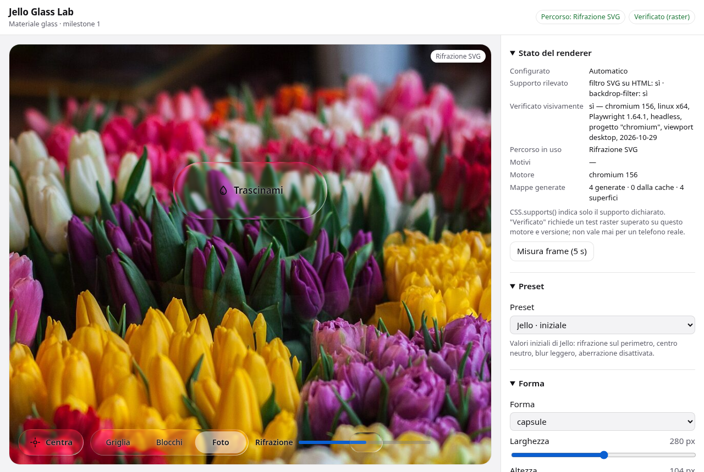

# Jello Glass Lab

Jello sviluppa un materiale glass dinamico per componenti web, browser Android e app
basate su WebView. Si ispira ai principi di Apple Liquid Glass (lente, luce che segue la
geometria, risposta al tocco), ma **non** replica lo shader di Apple: parametri e modello
ottico sono di Jello.

Questa prima milestone contiene:

- un **nucleo** riutilizzabile, indipendente da framework (`src/core/`);
- il **laboratorio** interattivo per valutare blur, rifrazione, luce e movimento separatamente (`src/lab/`);
- **test** unitari sulla geometria e test Playwright con confronti raster (`tests/`).



## Avvio

Richiede Node ≥ 20 (≥ 22.6 per `npm run geometry:cases`).

```sh
npm install
npm run dev          # http://localhost:5173
```

Il laboratorio accetta parametri nell'URL per riprodurre uno scenario, per esempio
`/?preset=optics&scene=grid&animate=0&components=0&path=refraction`.
Chiavi: `preset`, `scene` (`grid` `text` `blocks` `photo` `solid` `coords`), `path`
(`auto` `refraction` `satin` `opaque`), `animate`, `compare`, `map`, `components`,
`reduceMotion`, `reduceTransparency`, `theme` (`light` `dark`).

## Build e test

```sh
npm run typecheck    # TypeScript, modalità rigorosa
npm run build        # typecheck + build Vite in dist/
npm test             # Vitest: geometria, parametri, molla, scelta del percorso
npx playwright install chromium firefox webkit
npm run test:e2e:local   # Chromium, Firefox, viewport Pixel 7 emulato
npm run test:e2e         # come sopra + WebKit (richiede le sue dipendenze di sistema)
npm run test:perf        # confronto 1/4 superfici, sfondo fermo/animato → docs/perf/
npm run verify           # typecheck + unit + build + e2e locali
```

Quando la suite raster (`tests/e2e/raster.spec.ts`) passa per intero su un motore, scrive
`verification/<progetto>.json`. Il laboratorio legge questi record per mostrare se il
motore e la versione in uso sono stati **verificati visivamente**. Un record desktop o
emulato non vale mai per un telefono o una WebView reali.

## Come funziona

Tre ruoli espliciti (dettagli in [docs/rendering.md](docs/rendering.md)):

| Ruolo          | Elemento                          | Cosa fa                                                                 |
| -------------- | --------------------------------- | ----------------------------------------------------------------------- |
| **GlassSource**  | `.jello-source` (es. `#sourceMain`) | Contenuto che può essere rifratto. Riceve `filter: url(#…)`.             |
| **GlassSurface** | `span.jello-surface` nell'host    | Geometria e materiale: tinta, luce, ombra. Nessun filtro.               |
| **Foreground**   | figli dell'host                   | Testi, icone, controlli. Fuori dalla sorgente, mai filtrati né scalati. |

```ts
import { GlassContext, bindDrag, bindPress, defaultParams } from './src/core';
import './src/core/glass.css';

const overlay = document.querySelector<HTMLElement>('#overlay')!; // stesso riquadro della sorgente
const ctx = new GlassContext({ source: document.querySelector('#source')!, path: 'auto' });
const capsule = ctx.attach(document.querySelector('#capsule')!, { params: defaultParams(), sizing: 'params' });
bindDrag(capsule, { bounds: () => ({ width: overlay.clientWidth, height: overlay.clientHeight }) });
const button = ctx.attach(document.querySelector('#button')!, { params: defaultParams(), sizing: 'element' });
bindPress(button);
// ...
ctx.destroy(); // rimuove filtri, observer, listener e loop
```

Percorsi di rendering, scelti da `resolvePath` e sempre visibili nel laboratorio:

1. **Rifrazione** — filtro SVG sulla sorgente, con una catena di primitive per lente limitata
   alla sua regione: mappa di displacement generata dalla geometria, blur, saturazione,
   `feDisplacementMap`, ritaglio sulla forma.
2. **Satinato** — `backdrop-filter: blur() saturate()` sulla superficie, senza rifrazione.
3. **Opaco** — superficie opaca e bordo; usato con `forced-colors`, `prefers-contrast: more`,
   `prefers-reduced-transparency` o la riduzione manuale della trasparenza.

La mappa viene rigenerata solo quando cambia la geometria (dimensioni, raggio, fascia,
profilo, lente centrale) ed è in cache per chiave. Spostamento, pressione ed elasticità
aggiornano solo attributi e trasformazioni. Il ciclo `requestAnimationFrame` gira solo
mentre una molla è in movimento.

Il modello dei parametri, con unità, intervalli e valori iniziali, è in
[docs/material-model.md](docs/material-model.md).

## Struttura

```
src/core/params.ts              parametri: tabella, valori iniziali, validazione, JSON
src/core/geometry.ts            geometria della lente (pura, deterministica)
src/core/spring.ts              molla a passo fisso
src/core/presets.ts             preset (Cable e BT come approssimazioni dichiarate)
src/core/renderer/              rilevamento, scelta del percorso, filtro SVG
src/core/surface.ts             superficie: materiale, movimento, lente
src/core/context.ts             sorgente + superfici + preferenze di sistema
src/core/interaction.ts         pressione e trascinamento
src/core/glass.css              materiale, percorsi, accessibilità
src/lab/                        laboratorio
tests/unit/, tests/e2e/         Vitest, Playwright
verification/                   record delle verifiche raster superate
docs/                           scelte, compatibilità, riferimenti, Android, misure
```

## Stato delle verifiche (29 ottobre 2026)

Riepilogo; evidenze e limiti in [docs/compatibility.md](docs/compatibility.md).

| Ambiente                                  | Esito                                                    |
| ----------------------------------------- | -------------------------------------------------------- |
| Chromium 156 headless, desktop            | e2e superati, rifrazione verificata sul raster           |
| Firefox 157 headless, desktop             | e2e superati, rifrazione verificata sul raster           |
| Viewport Pixel 7 emulato (Chromium 156)   | e2e superati; è emulazione, non un telefono              |
| WebKit (Playwright)                       | **non eseguito**: dipendenze di sistema mancanti su Fedora |
| Chrome Android reale, Android WebView     | **non verificati**: procedura in [docs/device-testing.md](docs/device-testing.md) |

## Documenti

- [Scelte di rendering](docs/rendering.md)
- [Modello del materiale](docs/material-model.md)
- [Compatibilità ed evidenze](docs/compatibility.md)
- [Riferimenti e attribuzioni](docs/references.md)
- [Renderer Android: indicazioni](docs/android.md)
- [Prove su dispositivo](docs/device-testing.md)

## Licenze

Il codice di Jello è scritto per questo progetto; non contiene codice copiato dai
riferimenti (vedi [docs/references.md](docs/references.md)). La fotografia di prova è CC0
([public/assets/ATTRIBUTION.md](public/assets/ATTRIBUTION.md)). La repository non dichiara
ancora una licenza propria: `package.json` usa `UNLICENSED` finché non viene scelta.
